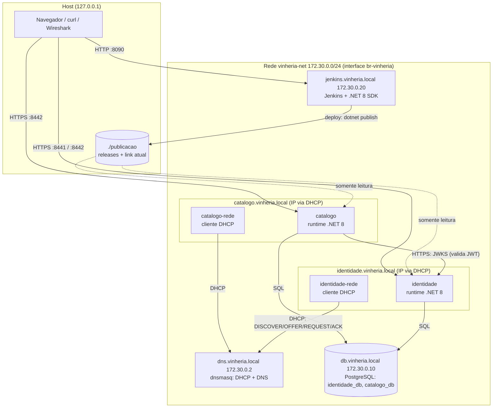
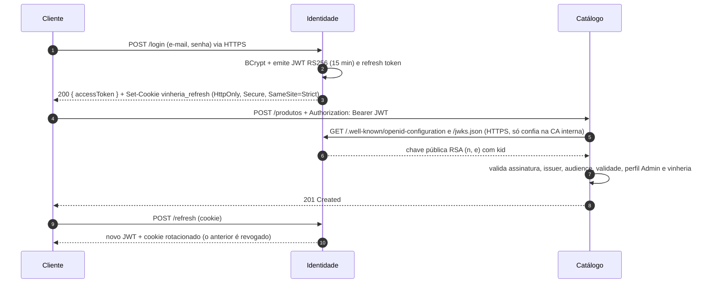
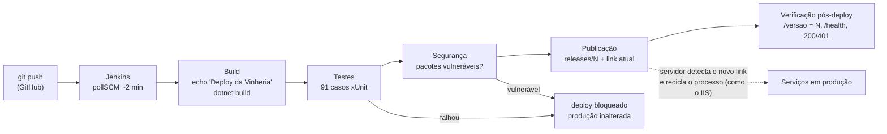

# 🍷 Vinheiro — Fase 7: Infraestrutura, DevOps e Comunicação Segura

> Simulação de parte da [arquitetura de microsserviços (Fase 6)](MICROSERVICES_ARCHITECTURE.md): dois microsserviços
> em .NET 8 rodando em containers, com rede própria (DHCP + DNS), comunicação autenticada e criptografada,
> pipeline de CI/CD no Jenkins e demonstração de tráfego inseguro × seguro no Wireshark.

---

## 📋 Índice

1. [Visão geral](#1-visão-geral)
2. [Serviços escolhidos](#2-serviços-escolhidos)
3. [Infraestrutura simulada](#3-infraestrutura-simulada)
4. [Como executar](#4-como-executar)
5. [Segurança e autenticação](#5-segurança-e-autenticação)
6. [Pipeline de deploy (Jenkins)](#6-pipeline-de-deploy-jenkins)
7. [Demonstração com Wireshark](#7-demonstração-com-wireshark)
8. [Testes automatizados](#8-testes-automatizados)
9. [Decisões, simplificações e limitações](#9-decisões-simplificações-e-limitações)
10. [Problemas encontrados e soluções](#10-problemas-encontrados-e-soluções)

---

## 1. Visão geral

| Requisito da fase | Como foi atendido |
|---|---|
| Escolher 2 microsserviços | **Identidade** (novo) e **Catálogo** (evolução da API C# de produtos) |
| Rede e serviços em containers | `docker-compose.yml`: rede `vinheria-net` (172.30.0.0/24) com DNS, banco, serviços e Jenkins |
| DHCP e DNS com registro dos serviços | **dnsmasq**: os serviços recebem IP por DHCP e o nome é registrado automaticamente no DNS (`*.vinheria.local`) |
| Repositório Git | Este repositório (GitHub); o Jenkins lê o `Jenkinsfile` direto dele |
| Pipeline Jenkins com build e deploy | `Jenkinsfile`: Build (`echo "Deploy da Vinheria"`) → Testes → Segurança → Publicação → Verificação pós-deploy |
| Deploy em pasta de publicação (simula IIS) | `./publicacao/<serviço>/releases/<build>` + link `atual`; servidores de aplicação reciclam o processo a cada deploy |
| Comunicação entre microsserviços | REST + **JWT RS256**; o Catálogo valida tokens com a chave pública (JWKS) obtida da Identidade pelo DNS |
| Autenticação | Login com BCrypt, JWT de 15 min, refresh token em cookie `httpOnly` com rotação, RBAC por perfil e vinheria |
| Wireshark: sem segurança × criptografia | Modo inseguro (HTTP) expõe senha, tokens e dados; modo padrão (HTTPS/TLS 1.3 com CA interna) não |

---

## 2. Serviços escolhidos

| Serviço | Pasta | Responsabilidade | Banco |
|---|---|---|---|
| **Identidade** | `identidade-api/` | Login, emissão de JWT (RS256), refresh token, publicação da chave pública (JWKS) | `identidade_db` |
| **Catálogo** | `csharp-api/` | Produtos (vinhos): leitura pública, escrita só para Admin da própria vinheria | `catalogo_db` |

**Por que esse par:** o Catálogo já existia (API C# da spec 010) e só precisou de autenticação; a Identidade é o
serviço novo mais simples e cobre sozinha o requisito de autenticação. Os dois **se comunicam de verdade**: para
validar um token, o Catálogo busca na Identidade, pelo nome `identidade.vinheria.local`, o documento de descoberta
OpenID e a chave pública (JWKS).

### Rotas

| Serviço | Método e rota | Acesso | Descrição |
|---|---|---|---|
| Identidade | `POST /api/v1/identidade/login` | público | E-mail + senha → JWT (corpo) + refresh token (cookie) |
| Identidade | `POST /api/v1/identidade/refresh` | cookie | Novo JWT; refresh token rotacionado |
| Identidade | `POST /api/v1/identidade/logout` | cookie | Revoga o refresh token e apaga o cookie |
| Identidade | `GET /.well-known/openid-configuration`, `GET /.well-known/jwks.json` | público | Descoberta e chave pública para validar os tokens |
| Catálogo | `GET /api/v1/catalogo/produtos[/{id}]` | público | Consulta do catálogo |
| Catálogo | `POST/PUT/DELETE /api/v1/catalogo/produtos[/{id}]` | Admin | Cadastro/edição/exclusão (somente da própria vinheria) |
| ambos | `GET /health`, `GET /versao` | público | Saúde e versão em execução (usadas pelo pipeline) |

A rota antiga `/api/produtos` (spec 010) continua ativa no Catálogo, com as mesmas regras de acesso.

---

## 3. Infraestrutura simulada



### Endereçamento

| Faixa | Uso |
|---|---|
| `172.30.0.1` | gateway da bridge do Docker |
| `172.30.0.2` – `.63` | servidores de infraestrutura com IP fixo: DNS (`.2`), banco (`.10`), Jenkins (`.20`) |
| `172.30.0.64` – `.127` | IPs internos atribuídos pelo Docker (usados só para publicar portas no host) |
| `172.30.0.200` – `.250` | **faixa DHCP** do dnsmasq para os serviços de aplicação |

### DHCP e DNS (dnsmasq)

- Configuração comentada em [`infra/dnsmasq/dnsmasq.conf`](../infra/dnsmasq/dnsmasq.conf): faixa DHCP, gateway, DNS,
  domínio `vinheria.local` e registros fixos (`dns`, `db`, `jenkins`, `gateway`).
- Cada serviço tem um **container de rede** (`identidade-rede`, `catalogo-rede`) que é dono da interface: ele pede o
  IP ao dnsmasq informando o próprio nome (opção 12 do DHCP) e o dnsmasq **registra o nome automaticamente** no DNS.
  O container do serviço .NET entra nessa interface (`network_mode`), como o *pause container* de um pod do Kubernetes.
  Assim, reiniciar o serviço (deploy, falha) não perde o IP nem o registro.
- Só o container de rede tem a permissão `NET_ADMIN`; o serviço .NET roda sem privilégios.
- As concessões ficam no volume `dns-concessoes`: reiniciar o dnsmasq não apaga os nomes do DNS.
- Os serviços se comunicam **sempre pelo nome completo** (`*.vinheria.local`). Nomes curtos (`identidade`) são
  respondidos pelo DNS interno do Docker com o IP do Docker, não com o do DHCP.

### Banco de dados (Database per Service)

Um único PostgreSQL com **um banco e um usuário por serviço** ([`infra/postgres/00-criar-bancos.sh`](../infra/postgres/00-criar-bancos.sh)).
O acesso público (`CONNECT`) é revogado: o usuário da Identidade não consegue nem se conectar ao banco do Catálogo.

---

## 4. Como executar

> Passo a passo completo — instalação por sistema operacional, uso, Jenkins, testes e solução de problemas:
> **[FASE7_GUIA_EXECUCAO.md](FASE7_GUIA_EXECUCAO.md)**. Resumo:

**Pré-requisitos:** Docker com o plugin Compose, `bash`, `openssl` e `curl` (no Windows, use o WSL 2).

```bash
./infra/scripts/configurar-ambiente.sh   # 1x: chave JWT, CA interna, certificados, senhas (.env) e deploy inicial (v0)
docker compose up -d --build             # sobe tudo em HTTPS (modo padrão)
./infra/scripts/verificar-rede.sh        # evidências: DHCP, DNS, TLS, comunicação e fluxo de login
```

| Endereço (host) | O quê |
|---|---|
| `https://localhost:8441` | Identidade (HTTPS) |
| `https://localhost:8442` | Catálogo (HTTPS) |
| `http://localhost:8090` | Jenkins (usuário `admin`, senha `JENKINS_ADMIN_PASSWORD` do `.env`) |

O certificado é emitido pela CA interna: use `curl --cacert infra/secrets/tls/ca.crt ...` (ou importe
`infra/secrets/tls/ca.crt` no navegador). Usuários de demonstração: `admin@agnello.com` / `admin123` (Admin) e
`cliente@agnello.com` / `cliente123` (Cliente).

```bash
# Exemplo: login e cadastro de produto
CA=infra/secrets/tls/ca.crt
TOKEN=$(curl -s --cacert $CA -H 'Content-Type: application/json' \
  -d '{"email":"admin@agnello.com","senha":"admin123"}' https://localhost:8441/api/v1/identidade/login \
  | sed -E 's/.*"accessToken":"([^"]+)".*/\1/')
curl -s --cacert $CA -H "Authorization: Bearer $TOKEN" -H 'Content-Type: application/json' \
  -d '{"nome":"Malbec","tipo":"Tinto","preco":89.9}' https://localhost:8442/api/v1/catalogo/produtos
```

| Comando | Para quê |
|---|---|
| `docker compose -f docker-compose.yml -f docker-compose.inseguro.yml up -d` | Modo **inseguro** (HTTP puro) — só para a demonstração no Wireshark |
| `docker compose up -d` | Volta ao modo seguro (HTTPS) |
| `./infra/scripts/gerar-trafego-demo.sh` | Gera o tráfego da demonstração (login, chamada autenticada, refresh, logout) |
| `./infra/scripts/capturar-trafego.sh <nome>` | Captura a `br-vinheria` em `capturas/<nome>.pcap` (necessário no Windows/macOS) |
| `./infra/scripts/rodar-testes.sh` | Roda os 91 testes (no .NET 8 local ou no container do SDK) |
| `./infra/scripts/rollback.sh identidade [versão]` | Volta um serviço para uma versão já publicada |
| `docker compose down -v` | Remove tudo, inclusive bancos e Jenkins (volumes) |

> **Jenkins:** o job acompanha a branch `main` do repositório no GitHub.

---

## 5. Segurança e autenticação



| Camada | Prática aplicada |
|---|---|
| **Senhas** | Hash BCrypt (custo 10); comparação contra hash fictício quando o usuário não existe (mitiga timing); mesma mensagem 401 para qualquer falha (sem enumeração de usuários) |
| **Token de acesso** | JWT **RS256** de 15 min com `sub`, `role`, `vinheria_id`, `jti`; só a Identidade tem a chave privada; os demais serviços usam a chave pública (JWKS) |
| **Refresh token** | Opaco (256 bits), só em cookie `HttpOnly` + `Secure` + `SameSite=Strict` restrito a `/api/v1/identidade`; banco guarda só o hash SHA-256; **rotação** a cada uso; **reuso de token revogado** derruba todas as sessões do usuário (sinal de roubo) |
| **Autorização** | RBAC: leitura pública; escrita só `Admin` (403 para Cliente); isolamento multi-tenant — Admin só altera produtos da própria vinheria e a vinheria do produto vem do token, nunca do corpo |
| **TLS** | HTTPS (TLS 1.3) em todos os serviços; CA interna própria; o Catálogo só aceita a Identidade com certificado dessa CA e nome correto (`CustomRootTrust`) — simulação de *man-in-the-middle* com outra CA resulta em 401; HSTS em produção |
| **Segredos** | Fora do repositório: `.env` (senhas), `infra/secrets/` (chave JWT, CA, certificados); a chave da CA nunca entra nos containers; testes de regressão falham o build se houver senha ou chave em `appsettings*.json` |
| **Menor privilégio** | Serviços .NET como usuário não-root; `NET_ADMIN` só nos containers de rede; pasta de publicação montada somente leitura; um usuário de banco por serviço; Jenkins **sem** acesso ao Docker do host |
| **DevSecOps** | Pipeline bloqueia o deploy se houver pacote NuGet com vulnerabilidade conhecida (inclusive transitiva) |
| **Exposição** | Portas publicadas só em `127.0.0.1`; HTTP desligado no modo padrão |

---

## 6. Pipeline de deploy (Jenkins)



- **Jenkins como código:** a imagem ([`infra/jenkins/`](../infra/jenkins)) já vem com .NET 8 SDK, plugins e
  [`casc.yaml`](../infra/jenkins/casc.yaml) (JCasC), que cria o usuário `admin`, a segurança e o job `vinheria-deploy`
  ("Pipeline script from SCM" apontando para o GitHub). Não há configuração manual.
- **[`Jenkinsfile`](../Jenkinsfile):** cinco etapas; o build é disparado automaticamente pelo `pollSCM` a cada mudança
  no repositório (ou manualmente em *Build Now*).
- **Publicação (simula o IIS):** [`publicar.sh`](../infra/scripts/publicar.sh) faz `dotnet publish` em
  `publicacao/<serviço>/releases/<build>` e troca o link `atual` de forma atômica. Os containers `identidade` e
  `catalogo` usam só o runtime do .NET e executam [`executar.sh`](../infra/runtime/executar.sh), que roda a versão em
  `atual` e **recicla o processo** quando o link muda (log: `novo deploy detectado: versão 3 -> 4`).
- **Verificação pós-deploy:** [`verificar-deploy.sh`](../infra/scripts/verificar-deploy.sh) espera cada serviço responder
  `/versao` com o número do build (por HTTPS, pelo DNS interno) e confere `/health` e as regras de acesso.
- **Rollback:** as 5 últimas versões ficam guardadas; `./infra/scripts/rollback.sh identidade` volta à anterior em segundos.

```
publicacao/
├── identidade/
│   ├── atual -> releases/4
│   └── releases/{0,1,2,3,4}/   (IdentidadeApi.dll, appsettings.json, VERSAO, ...)
└── catalogo/
    ├── atual -> releases/4
    └── releases/{0,1,2,3,4}/
```

---

## 7. Demonstração com Wireshark

Objetivo: mostrar o que um atacante na mesma rede enxerga **sem criptografia** e **com TLS**.

**Preparação (Linux):** instale o Wireshark (`sudo dnf install wireshark` ou `sudo apt install wireshark`) e dê
permissão de captura ao seu usuário (`sudo usermod -aG wireshark $USER` e faça logout/login), ou abra com `sudo`.
Capture sempre na interface **`br-vinheria`** (a bridge da rede dos containers). No **Windows/macOS** (Docker Desktop)
essa interface fica dentro da VM do Docker: use `./infra/scripts/capturar-trafego.sh <nome>` e abra o `.pcap` gerado
em `capturas/` no Wireshark.

> Capturas prontas, geradas e verificadas com `tcpdump`, ficam em `capturas/` (ignorada pelo git) quando existirem:
> `demo-http-inseguro.pcap`, `demo-https-seguro.pcap` e `demo-dhcp-dns.pcap`. Podem ser abertas direto no Wireshark.

### Parte A — sem segurança (HTTP)

1. `docker compose -f docker-compose.yml -f docker-compose.inseguro.yml up -d`
2. Wireshark → interface `br-vinheria` → iniciar captura.
3. `./infra/scripts/gerar-trafego-demo.sh` → parar a captura.
4. Filtros e o que destacar (📸):

| Filtro | O que aparece em texto puro |
|---|---|
| `http.request.method == "POST" && http.request.uri contains "login"` → *Follow → HTTP Stream* | **e-mail e senha** (`"senha":"admin123"`), o **JWT** na resposta e o **refresh token** no `Set-Cookie` |
| `http.authorization` | o header `Authorization: Bearer eyJ...` enviado ao Catálogo |
| `http.request.uri contains "jwks"` | o Catálogo buscando a chave pública na Identidade (comunicação entre os serviços) |
| `http.cookie or http.set_cookie` | o cookie de sessão indo e voltando |
| `json` | os dados do produto cadastrado |

5. **Sequestro de sessão:** no pacote com `Authorization`, clique com o botão direito no header → *Copy → Value*, e use
   o token (válido por 15 min, **mesmo depois do logout** do script):

   ```bash
   curl -H "Authorization: Bearer <token-copiado>" -H 'Content-Type: application/json' \
     -d '{"nome":"Produto do atacante","tipo":"Tinto","preco":1}' http://127.0.0.1:8082/api/v1/catalogo/produtos
   # HTTP 201: o atacante agiu como o Admin
   ```

### Parte B — com criptografia (HTTPS / TLS 1.3)

1. `docker compose up -d` (volta ao modo seguro).
2. Nova captura em `br-vinheria` → `./infra/scripts/gerar-trafego-demo.sh` → parar.
3. Filtros (📸):

| Filtro | O que aparece |
|---|---|
| `http` | **nada** — não há HTTP legível |
| `tls` | só *Client Hello*, *Server Hello* e *Application Data* (conteúdo cifrado); *Follow → TLS Stream* mostra bytes ilegíveis |
| `tls.handshake.type == 1` | o *Client Hello*: a versão TLS 1.3 e o **SNI** (`identidade.vinheria.local`) |

**Para a discussão:** o TLS protege conteúdo (senha, tokens, cookies, dados), mas **metadados continuam visíveis**:
IPs, portas, tamanhos, horários e o nome do servidor (SNI). E um token roubado por outro meio (malware, log) continua
utilizável até expirar — por isso o JWT dura só 15 minutos e o refresh token fica em cookie `httpOnly`.

### Parte C — DHCP e DNS (infraestrutura)

1. Captura em `br-vinheria` com o filtro `dhcp or dns`.
2. `docker compose restart identidade-rede` (o serviço libera a concessão e pede outra) e, em seguida,
   `./infra/scripts/verificar-rede.sh`.
3. 📸 *DHCP Release* do IP antigo, *Discover* em broadcast (`0.0.0.0 → 255.255.255.255`), *Offer*, *Request* e *ACK*
   com o hostname `identidade`; depois, a consulta `A identidade.vinheria.local` respondida pelo dnsmasq (`172.30.0.2`)
   com o IP da nova concessão. O endereço pode mudar ou se repetir (o dnsmasq tende a devolver o mesmo IP ao mesmo
   cliente); o que a captura demonstra é a troca DHCP completa e o DNS respondendo com o IP concedido.

---

## 8. Testes automatizados

TDD em todas as funcionalidades novas (testes escritos antes, falhando, e depois a implementação).

| Projeto | Casos | Cobertura principal |
|---|---|---|
| `IdentidadeApi.Tests` | 37 | login (válido, senha errada, inexistente, inativo, hash corrompido, campos vazios), JWKS sem parâmetros privados, discovery com o issuer exato, validação do token só com a chave pública, token adulterado, chave de assinatura sem parte privada recusada, refresh token (cookie, hash, rotação, reuso derrubando todas as sessões, token expirado sem efeito, logout), `/versao`, ausência de segredos na configuração |
| `VinheriaApi.Tests` | 54 | CRUD, RBAC (401/403/201), isolamento entre vinherias, limites de entrada (400 em vez de 500), tokens inválidos (expirado, outra chave, audience/issuer errados), validação TLS com a CA interna (inclusive certificado sem uso de servidor), `/versao`, ausência de senha na configuração |

```bash
./infra/scripts/rodar-testes.sh   # .NET 8 local, ou container do SDK 8 se ele não estiver instalado
```

---

## 9. Decisões, simplificações e limitações

| Arquitetura da Fase 6 | Nesta simulação | Motivo |
|---|---|---|
| Consul (Service Discovery) | **DNS do dnsmasq** com registro automático via DHCP | Requisito da fase (DHCP + DNS); cumpre o papel de localizar os serviços pelo nome |
| API Gateway (Ocelot) | Acesso direto aos serviços (portas só em `127.0.0.1`) | Fora do escopo dos 2 serviços; a validação de token é feita em cada serviço |
| Kafka / Saga | Não utilizados | Os 2 serviços escolhidos só se comunicam de forma síncrona (JWKS) |
| Kubernetes | Docker Compose | Ambiente de laboratório |
| IIS (Windows Server) | Servidor de aplicação em container que recicla ao detectar deploy | Mesmo comportamento observável, multiplataforma |

**Limitações conhecidas:**

- O **.NET 8 saiu de suporte em 10/11/2026**; foi mantido por coerência com a Fase 6 e pelo prazo. Próximo passo: migrar para o .NET 10 (LTS).
- O Jenkins executa os builds no próprio controlador (nó único) e responde em HTTP em `localhost:8090`; em produção, usar agentes separados e HTTPS.
- Certificados emitidos por uma CA interna (autoassinada): navegadores só confiam após importar `ca.crt`.
- Mudanças de schema do banco não fazem parte do pipeline: o `init.sql` da Identidade é idempotente e deve ser reaplicado em bancos existentes quando houver tabelas novas.
- Depois de um logout, o JWT já emitido continua válido até expirar (é *stateless*); a mitigação adotada é a validade curta.
- A rotação do refresh token é estrita: duas renovações simultâneas com o mesmo token (ex.: duas abas) são tratadas como reuso e encerram as sessões do usuário. É o comportamento mais seguro; um sistema em produção poderia aceitar uma pequena janela de tolerância.
- As versões dos plugins do Jenkins não são fixadas (acompanham a imagem `lts`), e o `/health` indica se o processo responde, sem testar o banco; a verificação pós-deploy cobre o acesso ao banco do Catálogo.

---

## 10. Problemas encontrados e soluções

| Problema | Causa | Solução |
|---|---|---|
| Senha do banco exposta no repositório público | `appsettings.json` versionado com a connection string | Senha trocada; conexão por variável de ambiente; teste que falha o build se houver senha em arquivos de configuração |
| Todos os produtos pareciam ser da vinheria 1 | `SELECT *` sem alias: o Dapper não mapeia `vinheria_id` → `VinheriaId` | Colunas com alias explícito (sem isso o isolamento entre vinherias falharia) |
| Após reiniciar a Identidade, tokens novos eram recusados por até 5 min | Chave temporária + limite de 1 busca de JWKS a cada 5 min (consumível por tokens forjados) | Chave fixa montada no container; intervalo reduzido para 60 s |
| Reiniciar um serviço quebrava a comunicação | O cliente DHCP ficava preso à rede antiga do container | Container de rede dono da interface (padrão *pause container*) |
| Recriar o dnsmasq apagava os nomes do DNS | Concessões guardadas dentro do container | Concessões persistidas em volume |
| Healthcheck falhava em HTTPS | O `wget` do Alpine verifica certificados e não conhecia a CA interna | Healthcheck valida contra a CA interna (sem desligar a verificação) |
| Jenkins não iniciava | Opção de CSRF removida nas versões atuais, usada no JCasC | Remoção da opção (CSRF já é padrão) |
| Depois de reiniciar o Jenkins, o push não disparava mais o deploy | O JCasC recria o job a cada inicialização e descartava o gatilho registrado pelo `Jenkinsfile` | Gatilho `pollSCM` declarado também no job do JCasC |
| Scripts quebravam ao clonar no Windows / rodar no macOS | Quebra de linha CRLF e comandos exclusivos do GNU (`mv -T`, `head -n -N`) | `.gitattributes` forçando LF, alternativas portáveis e recomendação do WSL 2 no Windows |
