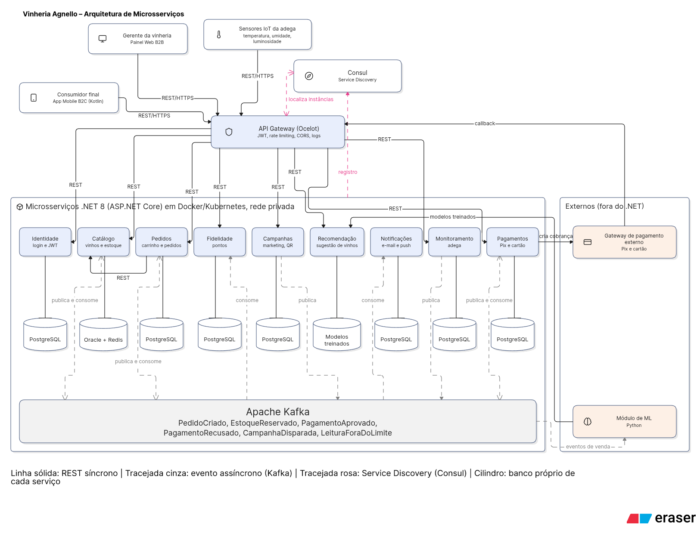
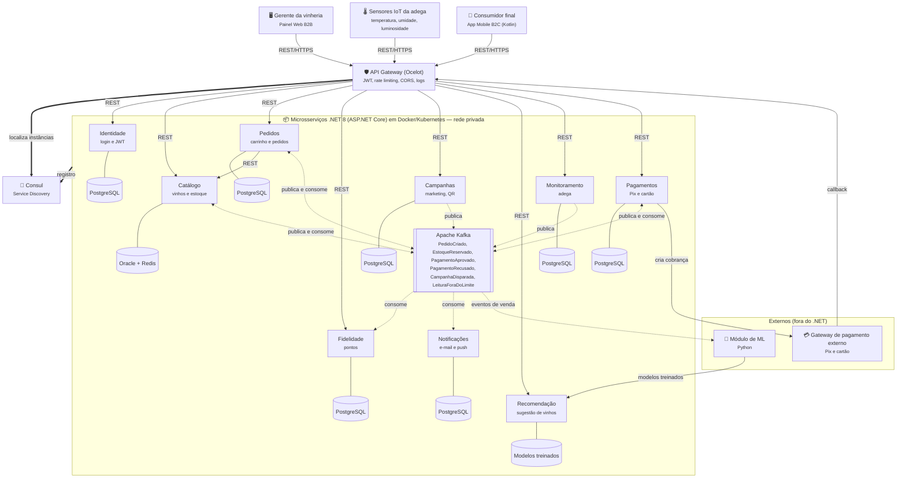

# 🍷 Vinheiro — Arquitetura de Microsserviços (Fase 6)

> Modelagem da arquitetura-alvo do sistema da Vinheria Agnello — Sprint 6 · 2026
> Status: **planejamento**. O sistema atual (API Java monolítica + API C# de produtos + módulo de ML em Python) continua sendo a implementação em produção; este documento descreve para onde ele vai migrar.
> Arquitetura atual (monolito em camadas): ver [PROJECT_ARCHITECTURE.md](PROJECT_ARCHITECTURE.md).
> **Fase 7:** os serviços de **Identidade** e **Catálogo** foram implementados em .NET 8 num ambiente simulado (Docker, DHCP/DNS, HTTPS, Jenkins) — ver [FASE7_INFRA_DEVOPS.md](FASE7_INFRA_DEVOPS.md), incluindo as simplificações em relação a este documento.

---

## 📋 Índice

1. [Identificação dos Serviços](#1-identificação-dos-serviços)
2. [Definição da Arquitetura](#2-definição-da-arquitetura)
3. [Padrões de Arquitetura](#3-padrões-de-arquitetura)
4. [Integração entre Microsserviços](#4-integração-entre-microsserviços)
5. [Segurança e Governança](#5-segurança-e-governança)
6. [Estratégia de Migração](#6-estratégia-de-migração)

---

## 1. Identificação dos Serviços

A plataforma atende dois públicos: consumidores finais (**B2C**, app Kotlin) e vinherias (**B2B**, painel web dos gerentes). Por isso, **todos os dados continuam associados à vinheria** (`vinheria_id`) a que pertencem.

Os microsserviços foram derivados das classes de serviço da API Java (Servlets + DAO), da API C# de produtos e do módulo de ML. Na nova arquitetura, **todos são desenvolvidos em .NET 8 (ASP.NET Core)** e publicados de forma independente.

### 1.1 Microsserviços identificados

| Microsserviço | Função | Origem no sistema atual |
|---|---|---|
| **Identidade** | Cadastro e login de clientes e administradores, emissão de tokens JWT, cadastro das vinherias | `UsuarioAdminService.autenticar` (`src/main/java/.../service/UsuarioAdminService.java`) |
| **Catálogo** | Vinhos, ocasiões, avaliações; controle e reserva de estoque | `ProdutoRepository` (`csharp-api/VinheriaApi/Repositories/ProdutoRepository.cs`) — `GET/POST /api/produtos`, `GET/PUT/DELETE /api/produtos/{id}` |
| **Pedidos** | Carrinho, criação de pedidos e controle de status | `PedidoService.criarPedido` |
| **Pagamentos** | Cobranças via Pix, cartão de crédito/débito no gateway externo; tratamento dos callbacks | `PagamentoService.registrarCallbackGateway` |
| **Fidelidade** | Crédito e consulta de pontos dos clientes | `FidelidadeService.adicionarPontos` |
| **Recomendação** | Recomendação de vinhos por contexto usando os modelos treinados pelo ML | `RecomendacaoService.obterRecomendacoes` |
| **Campanhas** | Gestão e disparo de campanhas de marketing; geração de QR Codes | `CampanhaService.despacharCampanha` e `QrCodeService.generateQrCodeBase64` |
| **Notificações** | Envio de e-mail e push (confirmação de pedido, alertas da adega) | **Novo** — evita que os demais serviços enviem avisos diretamente |
| **Monitoramento** | Recebe leituras de temperatura, umidade e luminosidade dos sensores IoT da adega, guarda histórico e publica alerta fora da faixa ideal | Entidades de IoT já existentes no banco; **integração com sensores é nova** |

> **Módulo de ML (`ml/train.py`) não é um microsserviço de negócio.** Ele treina os modelos de classificação (KNN, Regressão Logística, SVM, Decision Tree, Random Forest) a partir dos eventos de venda publicados no Kafka e os exporta para o serviço de **Recomendação**.

---

## 2. Definição da Arquitetura

### 2.1 Diagrama



*Figura 1: Diagrama de arquitetura de microsserviços. Fonte em alta resolução: [Google Drive](https://drive.google.com/file/d/14caeZmWYJAmP55XI2zeyvM91JnML3tcI/view?usp=sharing).*

A versão abaixo é o mesmo diagrama em **Mermaid** (o GitHub mostra como desenho), para que possa ser editado e versionado junto com o código.

**Legenda:** `──►` REST síncrono · `-.->` evento assíncrono (Kafka) · `==>` Service Discovery (Consul) · cilindro = banco próprio de cada serviço.



#### Conexões do diagrama (resumo textual)

| De | Para | Tipo | Descrição |
|---|---|---|---|
| App B2C, Painel B2B, Sensores IoT | API Gateway | REST/HTTPS | Toda entrada externa passa pelo gateway |
| API Gateway | Consul | Service Discovery | Localiza instâncias dos serviços |
| Microsserviços | Consul | Service Discovery | Registro + health check |
| API Gateway | Identidade, Catálogo, Pedidos, Fidelidade, Campanhas, Recomendação, Monitoramento, Pagamentos | REST | Roteamento `/api/v1/...` (Notificações não tem rota pública) |
| Pedidos | Catálogo | REST | Preço e disponibilidade |
| Pagamentos | Gateway de pagamento externo | REST | Cria cobrança |
| Gateway de pagamento externo | API Gateway → Pagamentos | REST (callback) | Aprovado / recusado / expirado |
| Catálogo, Pedidos, Pagamentos | Kafka | Evento | Publicam e consomem |
| Campanhas, Monitoramento | Kafka | Evento | Apenas publicam |
| Kafka | Fidelidade, Notificações | Evento | Apenas consomem |
| Kafka | Módulo de ML | Evento | Eventos de venda para treino |
| Módulo de ML | Recomendação | Exportação | Modelos treinados |

### 2.2 Componentes e comunicação

- **Clientes:** app B2C (Kotlin) e painel web B2B falam **apenas com o API Gateway**, via REST sobre HTTPS, enviando o JWT em cada requisição. Os sensores IoT também enviam leituras pelo gateway.
- **API Gateway (Ocelot):** único ponto exposto à internet. Valida o token, aplica rate limiting e roteia por prefixo (`/api/v1/identidade`, `/api/v1/catalogo`, `/api/v1/pedidos`, ...). Resolve o endereço dos serviços no **Consul**. Notificações **não tem rota pública**.
- **Microsserviços:** nove serviços .NET 8 em containers Docker, orquestrados por **Kubernetes**, em rede privada.
- **Bancos (Database per Service):** Catálogo usa **Oracle + cache Redis**; Recomendação armazena os modelos treinados; os demais usam **PostgreSQL**.
- **Comunicação:** síncrona (REST) quando é preciso resposta imediata; assíncrona (**Apache Kafka**) para o fluxo de compra e ações que podem ocorrer depois (pontos, notificações, alertas). Detalhes na [seção 4](#4-integração-entre-microsserviços).
- **Fora do ecossistema .NET:** o gateway de pagamento externo (Pix/cartão, avisa Pagamentos por callback) e o módulo de ML em Python.

---

## 3. Padrões de Arquitetura

### 3.1 Contexto: por que sair do monolito

Hoje a API Java concentra a maior parte das regras de negócio; todos os serviços compartilham **o mesmo banco** e são publicados juntos. Isso implica:

- uma falha em uma parte pode derrubar o sistema inteiro;
- não é possível escalar só a parte mais usada;
- qualquer alteração exige publicar a aplicação inteira.

Durante a migração a API Java continua ativa, e o módulo Python segue responsável pelo treinamento dos modelos.

### 3.2 API Gateway (Ocelot)

Ponto de entrada único: os clientes não conhecem o endereço de cada microsserviço. Rotas organizadas por serviço e versionadas (`/api/v1/catalogo`, `/api/v1/pedidos`, `/api/v1/pagamentos`).

Responsabilidades que hoje estão nos filtros da API Java e passam para o gateway:

| Responsabilidade | Hoje |
|---|---|
| Validação do JWT | `AuthFilter` |
| Identificação da vinheria pela URL | `TenantFilter` |
| CORS | `CorsFilter` |
| Rate limiting por cliente | — (novo) |
| Registro centralizado das requisições | — (novo) |

**Justificativa:** evita repetir autenticação/CORS em cada serviço, reduz a superfície de ataque (só o gateway é exposto) e permite **migração gradual** — as rotas começam apontando para a API Java e passam a apontar para cada microsserviço conforme ele fica pronto, sem alterar app nem site.

### 3.3 Service Discovery (Consul)

- Cada serviço se registra com nome lógico (`catalogo-service`, `pedidos-service`, ...) e expõe um **health check** nativo do ASP.NET Core (a API Java já tem o equivalente em `HealthServlet`).
- Gateway e serviços consultam o Consul pelo nome e recebem o endereço de uma instância saudável.
- Instâncias que falham no health check saem do registro automaticamente.

**Justificativa:** endereços de containers mudam a cada deploy/reinício no Kubernetes; permite várias instâncias em picos (Natal, Black Friday). O Consul é agnóstico de linguagem, importante enquanto Java, Python e .NET convivem.

### 3.4 Database per Service

Cada serviço é o **único dono dos seus dados**; ninguém acessa o banco de outro serviço — usa a API dele ou recebe eventos.

| Serviço | Dados | Banco |
|---|---|---|
| Identidade | vinherias, clientes, usuários administradores | PostgreSQL |
| Catálogo | vinhos, ocasiões, avaliações, estoque (absorve a API C# de produtos) | Oracle + Redis |
| Pedidos | pedidos e itens de pedido | PostgreSQL |
| Pagamentos | pagamentos e status | PostgreSQL |
| Fidelidade | configuração do programa e histórico de pontos | PostgreSQL |
| Campanhas | campanhas de marketing e leituras de QR Code | PostgreSQL |
| Notificações | histórico de avisos enviados | PostgreSQL |
| Monitoramento | sensores, alertas e leituras da adega | PostgreSQL |
| Recomendação | modelos treinados recebidos do ML | armazenamento próprio de modelos |

Todas as tabelas continuam com o identificador da vinheria (isolamento multi-tenant).

**Justificativa:** hoje o `PedidoService` altera diretamente o estoque na tabela de vinhos — qualquer mudança nessa tabela pode quebrar pedidos. Com o padrão, a reserva de estoque passa para o Catálogo (via evento `PedidoCriado`). Também permite deploy/escala independentes e isola consultas pesadas (relatórios) do checkout.

**Consequência:** deixa de existir a transação única de `criarPedido` (pedido + estoque + pagamento). Isso é resolvido pela Saga.

### 3.5 Saga (coreografia)

Fluxo de **finalização da compra** como sequência de transações locais:

1. **Pedidos** cria o pedido com status `aguardando_pagamento`;
2. **Catálogo** reserva o estoque;
3. **Pagamentos** cria a cobrança no gateway externo (Pix, crédito ou débito);
4. pagamento aprovado → **Pedidos** altera status para `pago`;
5. **Fidelidade** credita pontos e **Notificações** avisa o cliente.

**Compensação** (pagamento recusado ou Pix expirado), em ordem inversa: Catálogo libera o estoque → Pedidos altera para `cancelado`.

Detalhes de implementação:

- **Coreografia**, sem coordenador central: cada serviço publica um evento no Kafka ao concluir sua etapa (`PedidoCriado`, `EstoqueReservado`, `PagamentoAprovado`, `PagamentoRecusado`).
- Os **status de pedido e pagamento existentes** funcionam como estados da saga; as regras de transição atuais continuam valendo (ex.: pagamento aprovado não volta a pendente).
- **Outbox:** o evento é gravado na mesma transação local que altera os dados, para nenhum evento ser perdido.
- **Idempotência:** eventos duplicados são ignorados (ex.: pontos de um pedido não são creditados duas vezes).

**Justificativa:** substitui a transação única, evitando estados inconsistentes (pedido pago sem estoque, estoque preso por pagamento recusado). Essencial para Pix, cuja confirmação pode chegar minutos depois. Coreografia é mais simples para poucas etapas; se o fluxo crescer, pode migrar para **orquestração** pelo próprio serviço de Pedidos.

### 3.6 Relação entre os padrões

API Gateway é a porta de entrada e usa o Service Discovery para achar as instâncias. Database per Service garante independência; Saga devolve a consistência que essa independência tira. A resiliência (Circuit Breaker etc.) está na [seção 5.6](#56-resiliência).

---

## 4. Integração entre Microsserviços

### 4.1 Critério síncrono × assíncrono

| | Síncrona (REST/HTTPS) | Assíncrona (Kafka) |
|---|---|---|
| Quando usar | O chamador precisa da resposta para continuar e ela é imediata | A ação pode ocorrer depois, vários serviços reagem ao mesmo fato, ou a etapa pode demorar (ex.: Pix) |
| Acoplamento | Chamador espera e depende da disponibilidade do destino | Publicador não espera nem conhece os consumidores |
| Falha do destino | Erro (mitigado por timeout/retry/circuit breaker) | Evento fica no Kafka até o consumidor voltar |

**Regra geral:** consultas a dados de outro serviço são síncronas; **mudanças de estado** que interessam a outros serviços são **eventos**.

### 4.2 Comunicação síncrona (REST)

| Origem | Destino | Finalidade |
|---|---|---|
| App B2C e painel B2B | API Gateway | Todas as requisições dos usuários (login, catálogo, carrinho, pedidos, pagamentos) |
| API Gateway | Identidade, Catálogo, Pedidos, Pagamentos, Fidelidade, Campanhas, Recomendação, Monitoramento | Encaminhamento para a rota `/api/v1` correspondente, após validar o token |
| Pedidos | Catálogo | Preço e disponibilidade ao montar o carrinho e criar o pedido |
| Pagamentos | Gateway de pagamento externo | Criação da cobrança (Pix/cartão) e consulta de status |
| Gateway de pagamento externo | Pagamentos (via API Gateway) | Callback de aprovado, recusado ou expirado |
| Sensores IoT da adega | Monitoramento (via API Gateway) | Envio periódico das leituras |

- Chamadas síncronas são poucas, resolvem o destino no Consul e usam **timeout, retry e Circuit Breaker (Polly)**.
- O callback do gateway de pagamento chega pelo API Gateway, e o serviço de Pagamentos **verifica a assinatura do provedor** antes de aceitá-lo.
- **Identidade, Recomendação e Monitoramento não chamam outros serviços.** O JWT é validado no próprio gateway, sem consultar a Identidade a cada requisição. **Notificações não recebe chamadas diretas**, só eventos.

### 4.3 Comunicação assíncrona (Kafka)

| Evento | Publicado por | Consumido por | Efeito |
|---|---|---|---|
| `PedidoCriado` | Pedidos | Catálogo | Reserva do estoque |
| `EstoqueReservado` | Catálogo | Pagamentos | Criação da cobrança no gateway externo |
| `PagamentoAprovado` | Pagamentos | Pedidos, Fidelidade, Notificações, módulo de ML | Pedido → `pago`, crédito de pontos, aviso ao cliente, registro da venda para treino |
| `PagamentoRecusado` | Pagamentos | Catálogo, Pedidos, Notificações | Libera estoque, pedido → `cancelado`, aviso ao cliente. Também publicado quando o Pix expira |
| `CampanhaDisparada` | Campanhas | Notificações | Envio da campanha por e-mail/push ao público-alvo |
| `LeituraForaDoLimite` | Monitoramento | Notificações | Alerta por e-mail/push aos gerentes da vinheria |

- **Um tópico por serviço publicador:** `pedidos`, `catalogo`, `pagamentos`, `campanhas`, `monitoramento`.
- **Um consumer group por serviço consumidor**, para que vários serviços recebam o mesmo evento de forma independente.
- **Chave da mensagem = id do pedido** nos eventos de compra, garantindo ordem por pedido.
- **Payload mínimo:** ids do pedido, da vinheria e do cliente, valor da compra e um **id único do evento** (deduplicação).
- Biblioteca .NET: **Confluent.Kafka**.

### 4.4 Exemplo: finalização da compra

```
Cliente ──REST──► Gateway ──► Pedidos ──REST──► Catálogo (preço/disponibilidade)
                                │ grava pedido "aguardando_pagamento" + outbox
                                │ responde "pedido recebido" ao cliente
                                └─► [PedidoCriado]
Catálogo ◄── [PedidoCriado]  → reserva estoque → [EstoqueReservado]
Pagamentos ◄── [EstoqueReservado] ──REST──► gateway externo (cria cobrança)
App ──REST──► /api/v1/pagamentos (exibe QR Code Pix / resultado do cartão)
Gateway externo ──callback──► Pagamentos
   ├─ aprovado → [PagamentoAprovado] → Pedidos (pago), Fidelidade, Notificações, ML
   └─ recusado/expirado → [PagamentoRecusado] → Catálogo (libera), Pedidos (cancelado), Notificações
```

O cliente aguarda apenas as etapas síncronas (rápidas); o restante ocorre por eventos, sem conexões ou transações abertas.

---

## 5. Segurança e Governança

### 5.1 Importância

O e-commerce trata dados pessoais e de pagamento, protegidos pela **LGPD**. Em microsserviços cada API é uma possível porta de entrada, por isso a estratégia combina **autenticação**, **autorização** e **proteção dos dados** (em trânsito e armazenados).

### 5.2 Autenticação

- Centralizada no serviço de **Identidade**, com **JWT** — nenhum outro serviço lida com senhas; mesmo fluxo para app e site.
- Login: e-mail + senha → gateway → Identidade compara com o hash → emite JWT assinado (id do usuário, perfil, validade curta). O cliente envia o token no header `Authorization`.
- O **API Gateway valida assinatura e expiração** antes de encaminhar; token ausente/inválido/expirado → **HTTP 401**, sem chegar aos serviços.
- **Refresh token** renova o acesso sem novo login.
- Implementação: autenticação **JWT Bearer do ASP.NET Core**, configurada também no Ocelot.

### 5.3 Autorização (RBAC)

| Perfil | Permissões |
|---|---|
| Visitante (sem login) | Consultar o catálogo |
| **Cliente** | + carrinho, pedido e pagamento; consultar **somente os próprios pedidos** |
| **Administrador** (gerentes/funcionários da vinheria, painel B2B) | Todos os pedidos da sua vinheria; cadastrar/editar vinhos e estoque; campanhas e QR Codes; leituras e alertas da adega; configurar fidelidade |

- Permissões verificadas **em cada microsserviço**, não só no gateway; sem permissão → **HTTP 403**.
- Rotas restritas: `[Authorize(Roles = "Admin")]`.
- "Cliente só vê os próprios pedidos": comparação entre o usuário do token e o dono do pedido.

### 5.4 Proteção dos dados e da comunicação

- **HTTPS (TLS)** em todo o tráfego, inclusive entre serviços; serviços em rede privada, só o gateway exposto.
- **Rate limiting** no gateway (mitiga força bruta no login e negação de serviço).
- Senhas apenas como **hash com salt** (PBKDF2 ou bcrypt).
- **Dados de cartão não são armazenados** pela Agnello — ficam no gateway de pagamento (PCI DSS).
- Segredos (senhas de banco, chave do JWT) fora do código: variáveis de ambiente ou cofre de segredos (ex.: **Azure Key Vault**).
- **Kafka autenticado** com ACL por tópico: cada serviço só publica/consome o que precisa (ex.: ML só consome eventos de venda).
- **Credencial própria por sensor IoT**, impedindo registro de dados falsos.
- **LGPD:** coleta mínima, registro de consentimento e exclusão de dados pessoais sob solicitação.

### 5.5 Escalabilidade

- Escala **horizontal e independente** por serviço: Docker + Kubernetes com autoscaling por CPU/memória.
- Em picos (Natal, Black Friday) escalam apenas **Catálogo, Pedidos e Pagamentos**.
- Serviços **stateless** (sessão no JWT): qualquer instância atende qualquer requisição; gateway + Consul distribuem a carga.
- **Redis** no Catálogo evita ir ao banco a cada visita.
- **Kafka como amortecedor** em picos de pedidos: eventos são processados no ritmo de cada serviço.

### 5.6 Resiliência

- A falha de um serviço não pode comprometer o sistema (ex.: Notificações fora do ar não impede uma compra).
- **Polly** em todas as chamadas síncronas:
  - **Circuit Breaker** — suspende chamadas a um serviço/gateway externo que falha repetidamente, evitando falhas em cascata;
  - **Retry** com intervalos crescentes para falhas temporárias;
  - **Timeout** em todas as chamadas.
- Eventos permanecem no Kafka enquanto o consumidor está fora — sem perda de pedidos.
- **Health checks** do ASP.NET Core + Kubernetes reiniciando instâncias que não respondem.
- Database per Service isola falhas de banco; Saga compensa etapas que falharam.

### 5.7 Governança

- **OpenAPI (Swagger)** gerado a partir do código de cada API ASP.NET Core.
- **Versionamento na rota** (`/api/v1/pedidos`) para não quebrar app e site.
- Convenções comuns de nomes de rotas, JSON e códigos HTTP de erro.
- **Logs centralizados** com Serilog + ELK (Elasticsearch, Logstash, Kibana) e **correlation id** por requisição, para rastrear um pedido entre serviços.
- Painéis de tempo de resposta, taxa de erros e uso de recursos, com alertas.
- **Pipeline de CI/CD por serviço**, com testes automatizados e verificação de vulnerabilidades antes de cada publicação.
- Cada serviço tem uma **equipe responsável** pela sua evolução e pelo seu banco.

---

## 6. Estratégia de Migração

A modelagem da Fase 6 define que a migração é **gradual, guiada pelo API Gateway**, com a API Java ativa até o fim. A ordem abaixo é uma sugestão derivada dessas decisões (não é fixada pelo documento da fase):

1. Subir o **API Gateway (Ocelot)** apontando inicialmente todas as rotas para a API Java existente (strangler fig) e mover para ele a validação de JWT, tenant e CORS.
2. Subir o **Consul** e registrar a API Java (via `HealthServlet`) e os novos serviços.
3. Extrair os serviços um a um para .NET 8 — o **Catálogo** parte da API C# de produtos já existente (`csharp-api/`) — e redirecionar a rota correspondente no gateway quando cada um ficar pronto.
4. Introduzir o **Kafka** com Outbox para o fluxo de compra (Saga), substituindo a transação única de `PedidoService.criarPedido`.
5. Conectar o **módulo de ML** ao tópico de vendas e exportar os modelos para o serviço de Recomendação.
6. Desativar a API Java quando todas as rotas estiverem servidas pelos microsserviços.

---

*Arquitetura de Microsserviços v1.0 — Vinheiro · Sprint 6 · 2026*
